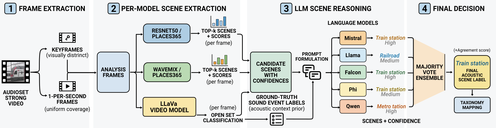
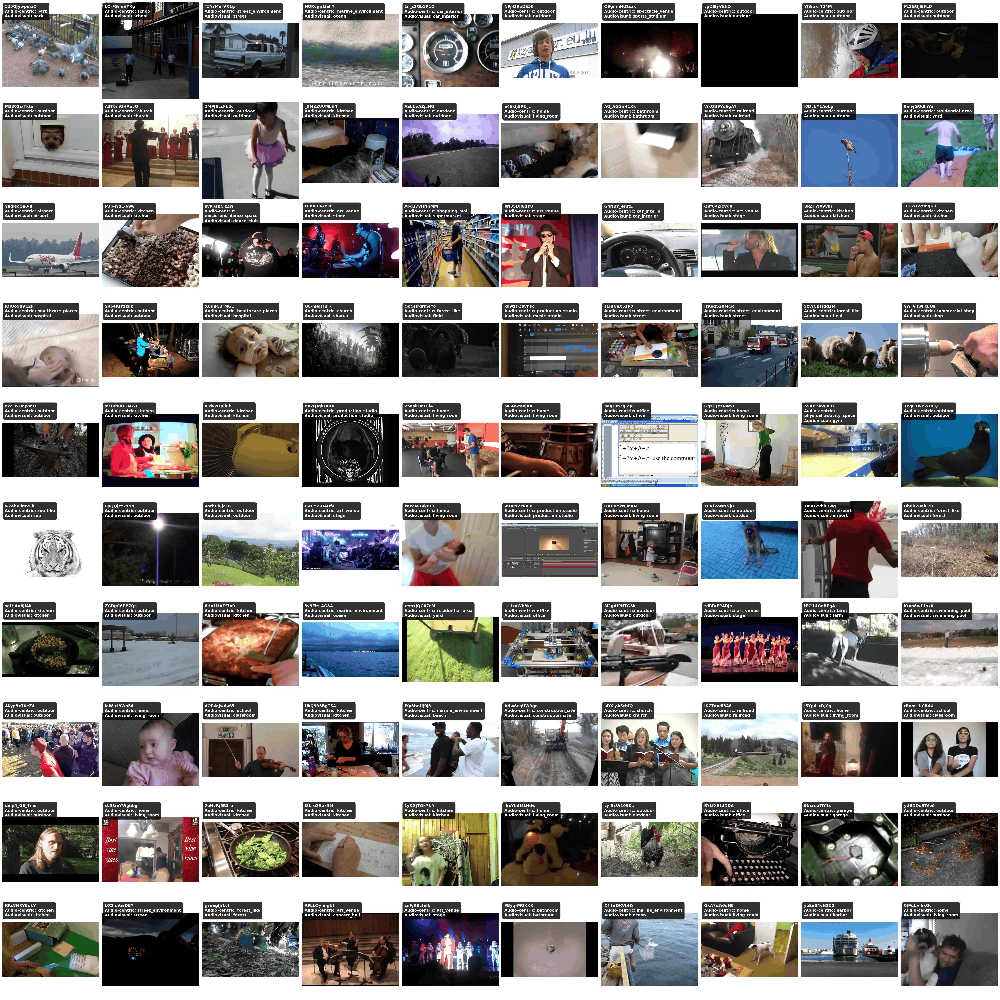

# SAS: Scene-Annotated AudioSet Strong for Joint Scene-Event Analysis

This repository provides **clip-level acoustic scene annotations for [AudioSet Strong](https://research.google.com/audioset/download_strong.html)**, which aims to foster researcher in joint acoustic scene and sound event analysis.

[📄 Paper (arxiv)](https://arxiv.org/pdf/2611.09199)

[🖼️ Poster (PDF)](_assets/DCASE2026_SAS_poster_revised.pdf)


## Scene Inference Pipeline

Scene annotations are generated through the following extraction pipeline: 



## Acoustic Scene Metadata

We provide scene annotations for **207,315 unique AudioSet Strong video identifiers**, organized under two complementary scene taxonomies:

- An **Audiovisual (AV) taxonomy**.
- An **Audio-centric (AC) taxonomy:**.

The released metadata includes:

- **Video identifier:** AudioSet Strong video ID associated with each annotation.
- **Scene label(s):** Predicted acoustic scene category under each taxonomy.
- **Scene aggrement:** Number of models supporting the final scene label.

Annotations may contain multiple scene labels when the ensemble voting results in a tie. Clips for which no reliable scene could be identified are labeled as `unknown`.

## Examples



## Citations

If you use these annotations, please cite:

```bibtex
@inproceedings{olvera2026b,
    author = "Olvera, Michel and Stamatiadis, Paraskevas and Serizel, Romain and Essid, Slim and Richard, Gaël",
    title = "SAS: Scene-Annotated AudioSet Strong for Joint Scene-Event Analysis",
    booktitle = "Proceedings of the 11th Workshop on Detection and Classification of Acoustic Scenes and Events (DCASE 2026)",
    address = "Boston, USA",
    month = "October",
    year = "2026"
}

@inproceedings{hershey2021benefit,
  title={The benefit of temporally-strong labels in audio event classification},
  author={Hershey, Shawn and Ellis, Daniel PW and Fonseca, Eduardo and Jansen, Aren and Liu, Caroline and Moore, R Channing and Plakal, Manoj},
  booktitle={ICASSP 2021-2021 IEEE International Conference on Acoustics, Speech and Signal Processing (ICASSP)},
  pages={366--370},
  year={2021},
  organization={IEEE}
}
```
